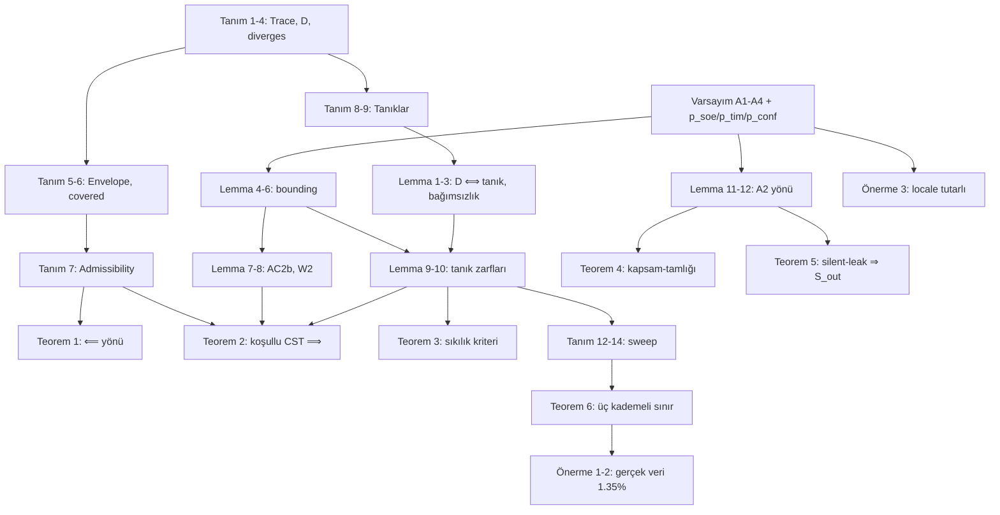

# CST — Formel Model (akış)

> [!info] Bu not ne
> Counterfactual Soundness Theorem'in **doğrusal, bağımlılık sıralı** formel sunumu:
> Tanım → Varsayım → Lemma → Teorem. Her madde yalnızca kendinden **önceki** maddelere
> dayanır; her madde Isabelle'de ispatlanmış bir fact'e karşılık gelir (`code` adı).
> Sembolik özet: [[Isabelle_Mechanization_CST_math]] · Kodlu log: [[Isabelle_Mechanization_CST]]

## 0. Giriş — ne, neden, nereden, nereye

### Ne yaptık
EXTp paper'ının merkezindeki iddia şudur: *hypervisor seviyesinde bir müdahale $do(X=x')$
yapıldığında ve divergence detector $D$ ateşlendiğinde, yayınlanan "X, gözlenen davranışın
nedenidir" claim'i Halpern–Pearl anlamında sağlamdır — ölçülebilir bir hata zarfı dahilinde.*
Paper bunu Teorem 1 (CST) olarak veriyor, ama App A'da "semi-formal sketch" diye
nitelendiriyordu. Biz bu sketch'in **koşullu çekirdeğini** Isabelle/HOL'de makine-kontrollü
hale getirdik: 94 ispatlı fact, `sorry` yok. Bu not, o mekanizasyonun matematiksel
iskeletini insan-okunur bir akış olarak sunar.

### Nereden geldik
Başlangıç sorusu daha iddialıydı: *"seL4'ün soyut API trace'leri ile VT-x mikromimari
durumu arasındaki lifting açığını kapat."* İncelemede iki şey görüldü:
1. Paper'ın kendisi **iki ayrı açık** sayıyor — abstraction-layer lifting ve
   empirical-to-structural lifting. İkincisi ölçümdür, hiçbir ispat sistemi kapatamaz.
2. Birincisi, CST teoreminin kritik yolunda **değil**: CST, A1–A4'ü *hipotez* olarak alan
   koşullu bir teoremdir. Lifting yalnızca A1'i, operasyonların bir alt-kümesi
   ($K_{verified}$) için düşürür; $K_{extended}$ zaten L4.verified kapsamı dışında.

Bu yüzden lifting **ertelendi** ve önce koşullu teoremin kendisi mekanize edildi
(Faz 0–2). Karar tek cümleyle: *"teoremi hipotezlerine göre ispatla; hipotezleri
düşürmek ayrı, çok-yıllık ve kısmen imkânsız bir iş."*

### Neden bu sırayla ilerledik — her aksiyonun gerekçesi

| Adım | Aksiyon | Neden alındı |
|---|---|---|
| Faz 0 | Trace/olay/$D$/envelope modeli (Bölüm I–II) | Paper'ın $D$ tanımı ve dört-adımlı admissibility'si **executable** hale gelsin; `by eval` sanity'ler regresyon koruması olsun. Timing farkı $\mathbb{Z}$'de: $\mathbb{N}$ çıkarması sessizce yanlış cevap verirdi. |
| Faz 1 | A1–A4 locale + $\Leftarrow$ yönü (Bölüm IV, Teorem 1) | Ampirik olasılıklar **soyut reel parametre** olarak dışarıdan girmeli; Isabelle onları üretmez. $\Leftarrow$ yönü paper'da "code inspection" ile kurulduğundan modelde de tanım gereği doğru olmalı. |
| Faz 2 | Koşullu CST $\Rightarrow$ yönü (Teorem 2) | Asıl deliverable: A1–A4 + admissibility ⇒ effectiveness, composition, AC1, AC2(a), AC2(b), zarf. |
| (a) | do-operatörü gerçek state-update (Lemma S) | İskeletteki `effective ≡ True` bir placeholder'dı; App A item (i) boştu. Pearl severance üç ayrı lemmaya bölündü ki hangi özelliğin ne verdiği görülsün. |
| (b) | AC2(a) iki tanığa ayrıldı, bağımsızlık ispatlandı (Bölüm III, VI) | $D$'nin OR yapısı gerçekten **iki ayrı kanıt** mı, yoksa tek kanıtın iki yazılışı mı? Karşı-örneklerle bağımsız olduğu gösterildi; bu, tanık-başına zarfın ön koşulu. Sonuç: paper'da türetilmemiş yeni kriter $\varepsilon_{SOE}\le\alpha$ (Teorem 3). |
| (d) | $A_2$ aktifleştirildi, `lem:silent` (Bölüm VII, Teorem 4) | $A_2$ Teorem 2'nin hipotezinde görünüp ispatta kullanılmıyordu — "ölü hipotez" şüphesi. Cevap: $A_2$ soundness'a değil **kapsam-tamlığına** çalışır. `effect` ayrı parametre yapılarak tautoloji tuzağından kaçınıldı; yanlışlanabilirlik `by eval` ile gösterildi (Lemma 13). |
| (f) | Paralel sweep, tanık-duyarlı zarf (Teorem 6) | (b) her claim'in zarfının tanığa bağlı olduğunu gösterdi; bir sweep'te farklı claim'ler farklı tanıkla ateşlenir ⇒ ensemble zarfı $n\cdot\mathrm{blanket}$'ten sıkı olmalı. Sıralı ($\delta$ birikimi) ve paralel eksenler bilinçli ayrıldı. |
| (h) | Gerçek 33-claim sweep verisine bağlama (Bölüm IX) | Teori artefakta değmeli: paper'ın gerçek sonucu (1/33 divergent) modele girildi; zarf 1.35% çıktı, naïve 52.47%'ye karşı. Sessiz input'ların bedava olması (d)×(f)'nin birleşimi. |
| (i) | Silent-leak = scope sınırı (Teorem 5) | Paper MI'ın sub-$\Delta^{*}$ sızıntı sınıfını "CMD'ye ertelendi" diyordu; keyfî görünüyordu. $A_2$ altında her sessiz sızıntının $S_{out}$'ta olmasının **zorunlu** olduğu ispatlanınca erteleme gerekçelendi. |
| (g) | seL4 lifting **arayüzü** (Bölüm X) | Açığı kapatmak kapsam dışı; ama yükümlülüğü **tek isimli assumption'a** indirgemek reviewer'a "tam olarak ne eksik" sorusunun cevabını verir. Kapatma **iddia edilmedi**. |
| (e) | Observable → 64/32-bit word | Gerçekçilik: yüzey yalnızca eşitlikle karşılaştırıldığından taşma riski yok; timing $\mathbb{N}$ kaldı çünkü TSC aritmetiği kapsam dışı. |
| (c) | Paper'a "machine-checked conditional core" işlendi | Yalnızca App A'ya — gövde ≤13pp NDSS limiti korunsun. |

### Nereye gidiyor
- **Bittiği yer:** koşullu teorem + dört antecedent'in tamamı en az bir ispatta aktif +
  teori deneysel artefakta bağlı. Mekanizasyonda anlamlı iş büyük ölçüde tamamlandı.
- **Açık kalan:** Varsayım L (`verified_no_fwk_touch`)'nin L4.verified'den türetilmesi —
  çok-yıllık; ampirik antecedent'ler — ilke olarak ispatlanamaz.
- **Sıradaki:** konsolidasyon ve paper cilası (formal-methods karşılaştırması §Related,
  App A'ya "mechanized fragment" tablosu). Yeni fact eklemek yerine mevcut iddiayı
  savunulabilir tutmak öncelik.

> [!quote] Yol gösteren ilke
> Her adımda soru aynıydı: *"Bu, teoremin iddiasını değiştiriyor mu, yoksa sadece
> gerçekçiliği mi artırıyor?"* İddiayı değiştirenler (b, d, f, h, i) önce; gerçekçilik
> artıranlar (e, g) sonra; ispatlanamayacak olanlar (ampirik, lifting) **dürüstçe dışarıda**.

---

## Bölüm I — Gözlem modeli

**Tanım 1 (Gözlemlenebilir yüzey, olay, trace).**
$$
\mathrm{Obs} := \mathbb{W}_{64}\times\mathbb{W}_{32}\times\mathbb{W}_{64}\times\mathbb{W}_{64}
\quad(\mathrm{rip},\mathrm{exit\_reason},\mathrm{exit\_qual},\mathrm{rax}),\qquad
\mathrm{Event} := \mathrm{Obs}\times\mathbb{N},\qquad
\mathrm{Trace} := \mathrm{Event}^{*}
$$
Bir olay $e=(o,\tau)$; $T!i$ trace'in $i$. olayı; $|T|$ uzunluk.

**Tanım 2 (Hizalama).** $\mathrm{aligned}(T_o,T_c) :\iff |T_o|=|T_c|$. — `aligned`

**Tanım 3 (İki divergence clause'u).** $\Delta^{*}\in\mathbb{N}$ için
$$
\mathrm{soe}(T_o,T_c,i) :\iff \mathrm{obs}(T_o!i)\neq\mathrm{obs}(T_c!i),\qquad
\mathrm{tim}_{\Delta^{*}}(T_o,T_c,i) :\iff \bigl|\tau(T_c!i)-\tau(T_o!i)\bigr|_{\mathbb{Z}}>\Delta^{*}
$$
— `soe_clause`, `timing_clause`. *(Fark $\mathbb{Z}$'de alınır; $\mathbb{N}$ çıkarması truncating olurdu.)*

**Tanım 4 (Divergence).**
$$
D_{\Delta^{*}}(T_o,T_c,i) :\iff \mathrm{soe}(T_o,T_c,i)\lor\mathrm{tim}_{\Delta^{*}}(T_o,T_c,i),\qquad
\mathrm{diverges}_{\Delta^{*}}(T_o,T_c) :\iff \exists i<|T_c|.\,D_{\Delta^{*}}(T_o,T_c,i)
$$
— `D`, `diverges`

**Lemma 0 (İndeks güvenliği).** $\mathrm{aligned}(T_o,T_c)\land i<|T_c|\implies i<|T_o|$. — `aligned_index_safe`
*İspat.* Tanım 2'den $|T_o|=|T_c|$. $\square$

**Lemma 0′ ($A_4$'ün operasyonel ifadesi).** $\mathrm{aligned}(T_o,T_c)\land\neg\mathrm{diverges}_{\Delta^{*}}(T_o,T_c)\implies\forall i<|T_c|.\ \mathrm{obs}(T_o!i)=\mathrm{obs}(T_c!i)$. — `no_divergence_obs_eq`
*İspat.* Tanım 4'ten her $i$ için $\neg\mathrm{soe}$; Tanım 3 açılır. $\square$

---

## Bölüm II — Müdahale modeli

**Tanım 5 (Müdahale, zarf).**
$$
\iota=(X,x',i,c)\in\mathbb{N}\times\mathbb{N}\times\mathbb{N}\times\mathrm{iclass},\qquad
\mathcal{E}=(\mathrm{instr},\mathrm{wl},\mathrm{gw},\mathrm{scp},S_{in},S_{out})
$$
$\mathrm{iclass}=\{\mathrm{NopCount},\mathrm{RegWrite},\mathrm{InputValue},\mathrm{CachePreload}\}$, $\mathrm{scope}=\{\mathrm{PerEvent},\mathrm{PerWindow},\mathrm{Global}\}$. — `intervention`, `envelope`

**Tanım 6 (CST v1.0 kapsamı).**
$$
\mathrm{covered}(\mathcal{E},\iota):\iff\mathrm{scp}(\mathcal{E})=\mathrm{PerEvent}\land c\in\mathrm{iclass}\land S_{in}\cap S_{out}=\varnothing
$$
— `cst_v1_covered`

**Tanım 6′ (do-operatörü).** Valuation $\sigma:\mathbb{N}\to\mathbb{N}$ için
$\mathrm{apply}_\iota(\sigma):=\sigma[X\mapsto x']$, $\ \mathrm{effective}(\iota):\iff\forall\sigma.\ \mathrm{apply}_\iota(\sigma)(X)=x'$. — `apply_iv`, `effective`

**Lemma S (Pearl severance, üç parça).**
1. $\mathrm{apply}_\iota(\sigma)(X)=x'$ — `apply_iv_severs`
2. $y\neq X\implies\mathrm{apply}_\iota(\sigma)(y)=\sigma(y)$ — `apply_iv_local`
3. $\mathrm{apply}_\iota(\sigma)(X)=\mathrm{apply}_\iota(\sigma')(X)$ her $\sigma,\sigma'$ için — `apply_iv_indep_pre`

*İspat.* Fonksiyon güncellemesinin tanımından. $\square$
**Sonuç S.** $\forall\iota.\ \mathrm{effective}(\iota)$. — `effective_holds`

**Tanım 7 (Dört-adımlı admissibility, emisyon).**
$$
\mathrm{adm}_{\Delta^{*}}(\mathcal{E},\iota,\mathsf{ok},T_o,T_c):\iff
\mathrm{covered}(\mathcal{E},\iota)\land\mathsf{ok}\land\mathrm{diverges}_{\Delta^{*}}(T_o,T_c)\land X\in S_{in}(\mathcal{E})
$$
$\mathrm{emits}:=\mathrm{adm}$. — `admissible`, `emits`

> **Teorem 1 (CST, $\Leftarrow$ yönü).** $\mathrm{emits}\iff\mathrm{adm}$. — `left_direction`
> *İspat.* Tanım gereği (App A: code-level inspection). $\square$

---

## Bölüm III — Tanıklar

**Tanım 8 (AC2(a) tanıkları).** $\mathcal{W}:=\{\mathsf{S},\mathsf{T}\}$,
$$
\mathrm{wit}(w,\Delta^{*},T_o,T_c,i):\iff\begin{cases}\mathrm{soe}(T_o,T_c,i)&w=\mathsf{S}\\ \mathrm{tim}_{\Delta^{*}}(T_o,T_c,i)&w=\mathsf{T}\end{cases}
$$
— `ac2a_witness`, `witnesses`

**Lemma 1 (D = tanık varlığı).** $D_{\Delta^{*}}(T_o,T_c,i)\iff\exists w.\ \mathrm{wit}(w,\Delta^{*},T_o,T_c,i)$. — `D_iff_witness`
*İspat.* Tanım 4 ve 8; iki yön case analizi. $\square$

**Lemma 2 (Her tanık yeter).** $\mathrm{soe}\implies D$; $\ \mathrm{tim}_{\Delta^{*}}\implies D$. — `structural_witness_suffices`, `timing_witness_suffices`

**Tanım 9 (Somut izler).** $e(r,er,eq,a;t)$ olay kurucusu.
$T_{orig}=[e(10,1,0,5;1000),e(14,2,0,5;1050)]$,
$T_{soe}=[e(10,1,0,5;1000),e(14,2,0,\mathbf{9};1050)]$,
$T_{tim}=[e(10,1,0,5;\mathbf{3000}),e(14,2,0,5;1050)]$,
$T_{silent}=[e(10,1,0,5;\mathbf{1400}),e(14,2,0,5;1050)]$.

**Lemma 3 (Tanıkların mantıksal bağımsızlığı).**
$$
\exists T_o,T_c,i,\Delta^{*}.\ \mathrm{wit}(\mathsf{S})\land\neg\mathrm{wit}(\mathsf{T})\quad\land\quad
\exists T_o,T_c,i,\Delta^{*}.\ \mathrm{wit}(\mathsf{T})\land\neg\mathrm{wit}(\mathsf{S})
$$
— `witnesses_logically_independent`
*İspat.* Birinci için $(T_{orig},T_{soe},1,500)$, ikinci için $(T_{orig},T_{tim},0,500)$; hesaplamayla (`by eval`). $\square$

---

## Bölüm IV — Varsayımlar (locale `cst_assumptions`)

**Varsayım A (Parametreler).** $\Delta^{*}\in\mathbb{N}$; $\ \delta_{A1},\varepsilon_{SOE},\alpha\in[0,1]$;
predikatlar $A_1,A_2,A_3,A_4$; katkılar $p_{soe},p_{tim},p_{conf}:\mathcal{E}\times\iota\to\mathbb{R}$;
$\mathrm{eff}:\mathcal{E}\to\mathcal{P}(\mathbb{N})$; nedensel etki predikatı $\mathrm{effect}(\mathcal{E},\iota,T_o,T_c,i)$.

**Varsayım A1 (CapSep, confounder).** $A_1(\mathcal{E},\iota)\implies 0\le p_{conf}\le\delta_{A1}+\alpha$. — `A1_bounds_conf`
**Varsayım A2 (Manifestasyon).** $A_2(\mathcal{E},\iota)\land X\in S_{in}\land\mathrm{effect}(\mathcal{E},\iota,T_o,T_c,i)\implies D_{\Delta^{*}}(T_o,T_c,i)$. — `A2_manifests`
**Varsayım A3 (MI, timing).** $A_3(\mathcal{E},\iota)\implies 0\le p_{tim}\le\alpha$. — `A3_bounds_tim`
**Varsayım A4 (SOE).** $A_4(\mathcal{E},\iota)\implies 0\le p_{soe}\le\varepsilon_{SOE}$. — `A4_bounds_soe`
**Varsayım E.** $\mathrm{eff}(\mathcal{E})\subseteq S_{in}(\mathcal{E})$. — `eff_subset`

> [!warning] Bu sayılar ölçümdür
> $\delta_{A1},\varepsilon_{SOE},\alpha$ Isabelle'de üretilmez; Clopper–Pearson / MI kalibrasyonundan girer.

**Tanım 10 (Kalıntı zarf).** $\mathrm{residual}:=\varepsilon_{SOE}+\delta_{A1}+\alpha$; $\ 0\le\mathrm{residual}\le3$. — `residual_nonneg`, `residual_le_three`

**Lemma 4 (SOE coincidence sınırı).** $A_4\implies p_{soe}\le\varepsilon_{SOE}$. — `coincidence_soe_bound`
**Lemma 5 (Timing coincidence sınırı).** $A_3\implies p_{tim}\le\alpha$. — `coincidence_timing_bound`
**Lemma 6 (Confounder sınırı).** $A_1\implies p_{conf}\le\delta_{A1}+\alpha$. — `confounder_bound`
*İspatlar.* Varsayımların doğrudan projeksiyonu. $\square$

---

## Bölüm V — HP korespondansı

**Tanım 11 (Witness kümesi, maskeleme, AC predikatları).**
$$
W(\mathcal{E}):=S_{in}\setminus\mathrm{eff}(\mathcal{E}),\qquad
\mathrm{mask}(\mathcal{E},\iota):=p_{soe}+p_{conf}
$$
$$
\mathrm{AC1}:=D_{\Delta^{*}},\quad \mathrm{AC2a}:=D_{\Delta^{*}},\quad \mathrm{AC2a}_w:=\mathrm{wit}(w,\Delta^{*},\cdot),\quad
\mathrm{AC2b}(\mathcal{E},\iota):\iff A_4\land W\subseteq S_{in}\land\mathrm{mask}\le\mathrm{residual}
$$
$$
\mathrm{comp}_\delta(\mathcal{E},\iota):\iff p_{conf}\le\delta_{A1}+\alpha
$$

**Lemma 7 (W2 union bound).** $A_1\land A_4\implies 0\le\mathrm{mask}(\mathcal{E},\iota)\le\mathrm{residual}$. — `w2_residual_bound`, `mask_prob_nonneg`
*İspat.* Lemma 4 + Lemma 6 toplanır: $p_{soe}+p_{conf}\le\varepsilon_{SOE}+(\delta_{A1}+\alpha)$. $\square$

**Lemma 8.** $W\subseteq S_{in}$; $\ A_1\implies\mathrm{comp}_\delta$; $\ A_1\land A_4\implies\mathrm{AC2b}$; $\ \mathrm{AC2a}\iff\exists w.\mathrm{AC2a}_w$.
— `witness_W_subset`, `composition_relaxed_holds`, `ac2b_holds`, `ac2a_iff_wit`
*İspat.* Sırasıyla küme farkı; Lemma 6; Lemma 7 + önceki; Lemma 1. $\square$

---

## Bölüm VI — Tanık-başına zarf ve ana teorem

**Tanım 12 (Tanık zarfı).**
$$
\mathrm{wb}(w,\mathcal{E},\iota):=\begin{cases}p_{soe}+p_{conf}&w=\mathsf{S}\\ p_{tim}+p_{conf}&w=\mathsf{T}\end{cases}
$$
— `wit_bound`

**Lemma 9 (Yapısal zarf).** $A_1\land A_4\implies\mathrm{wb}(\mathsf{S})\le\varepsilon_{SOE}+\delta_{A1}+\alpha$. — `wit_bound_structural`
**Lemma 10 (Zamanlama zarfı).** $A_1\land A_3\implies\mathrm{wb}(\mathsf{T})\le\delta_{A1}+2\alpha$. — `wit_bound_timing`
*İspatlar.* Lemma 4+6, Lemma 5+6. $\square$

> **Teorem 2 (Koşullu CST, $\Rightarrow$ yönü).** — `cst_conditional`
> $A_1,A_2,A_3,A_4(\mathcal{E},\iota)$, $\mathrm{aligned}(T_o,T_c)$, $\mathrm{adm}_{\Delta^{*}}(\mathcal{E},\iota,\mathsf{ok},T_o,T_c)$ ise
> $$
> \begin{aligned}
> &\mathrm{effective}(\iota)\land\mathrm{comp}_\delta(\mathcal{E},\iota)\land\exists i\,\exists w.\ \bigl[\,i<|T_c|\land i<|T_o|\land D_{\Delta^{*}}(T_o,T_c,i)\\
> &\quad\land\mathrm{AC1}\land\mathrm{AC2a}\land\mathrm{AC2a}_w\land\mathrm{AC2b}(\mathcal{E},\iota)
> \land\mathrm{wb}(w,\mathcal{E},\iota)\le\max(\varepsilon_{SOE}+\delta_{A1}+\alpha,\ \delta_{A1}+2\alpha)\,\bigr]
> \end{aligned}
> $$
> *İspat.* Tanım 7'nin 3. konjunktından $\mathrm{diverges}$, dolayısıyla $\exists i<|T_c|.\,D$. Lemma 0 ile $i<|T_o|$. Lemma 1 ile tanık $w$. $w=\mathsf{S}$ ise Lemma 9, $w=\mathsf{T}$ ise Lemma 10 ile zarf $\le\max(\cdot,\cdot)$. $\mathrm{effective}$: Sonuç S. $\mathrm{comp}_\delta$, $\mathrm{AC2b}$: Lemma 8. AC1/AC2a: Tanım 11 ile $D$'nin kendisi. $\square$

**Sonuç 2.1.** $A_1\land A_4\implies 0\le\mathrm{mask}\le\mathrm{residual}$ (per-claim raporlanan). — `cst_residual_reported`

> **Teorem 3 (Sıkılık kriteri).** — `structural_bound_tighter_iff`
> $$
> \varepsilon_{SOE}+\delta_{A1}+\alpha\le\delta_{A1}+2\alpha\iff\varepsilon_{SOE}\le\alpha
> $$
> *İspat.* Her iki taraftan $\delta_{A1}+\alpha$ çıkar. $\square$

**Sonuç 3.1 (Rejimler zıt tarafta).**
Within-boot $(\varepsilon,\delta,\alpha)=(0.37\%,0.37\%,0.61\%)$: kriter sağlanır, yapısal zarf $1.35\%\le1.59\%$. — `withinboot_criterion`, `withinboot_structural_tighter`
Cross-boot $(10.4\%,10.4\%,0.61\%)$: kriter ihlal, zamanlama zarfı $11.62\%\le21.41\%$. — `crossboot_criterion`, `crossboot_timing_tighter`

---

## Bölüm VII — $A_2$: kapsam-tamlığı ve silent-leak

**Lemma 11 (Soundness yönü, $A_2$ gerekmez).** $\mathrm{emits}\implies\mathrm{diverges}_{\Delta^{*}}(T_o,T_c)$. — `emits_implies_divergence`
*İspat.* Tanım 7. $\square$

**Lemma 12 (Etki kaçmaz, $A_2$ gerekli).** $A_2\land X\in S_{in}\land\mathrm{effect}(\cdot,i)\land i<|T_c|\implies\mathrm{diverges}_{\Delta^{*}}(T_o,T_c)$. — `silent_no_missed_effect`
*İspat.* Varsayım A2 ile $D(\cdot,i)$; Tanım 4. $\square$

> **Teorem 4 (Kapsam-tamlığı).** — `cst_scope_complete`
> $A_2$, $\mathrm{covered}$, $X\in S_{in}$, $\mathsf{ok}$, $\mathrm{effect}(\cdot,i)$, $i<|T_c|$ ise
> $\mathrm{emits}_{\Delta^{*}}(\mathcal{E},\iota,\mathsf{ok},T_o,T_c)\land\exists j<|T_c|.\,D_{\Delta^{*}}(T_o,T_c,j)$.
> *İspat.* Lemma 12 divergence'ı verir; Tanım 7'nin dört konjunktı hipotezlerden toplanır. $\square$

**Sonuç 4.1 (Sessizlik bilgilendiricidir).** $A_2\land X\in S_{in}\land\neg\mathrm{diverges}\land i<|T_c|\implies\neg\mathrm{effect}(\cdot,i)$. — `silence_informative_over_s_in`

**Lemma 13 ($A_2$ tautoloji değil).** $\tau(T_{silent}!0)\neq\tau(T_{orig}!0)\ \land\ \neg\mathrm{diverges}_{500}(T_{orig},T_{silent})$. — `silent_effect_exists`
*İspat.* $|1400-1000|=400\le500$, 4-tuple eşit; hesaplamayla. $\square$
*Yorum:* gerçek bir fark $D$'ye yansımıyor; bu fark $S_{in}$-içi etki olsaydı A2 ihlal edilirdi ⇒ A2 yanlışlanabilir.

**Tanım 13 (Silent leak).** $\mathrm{sl}(T_o,T_c,i):\iff\neg\mathrm{soe}\land\neg\mathrm{tim}_{\Delta^{*}}$ $\ (\iff\neg D_{\Delta^{*}})$. — `silent_leak`, `silent_leak_iff_not_D`

**Lemma 14.** $A_2\land X\in S_{in}\land\mathrm{effect}(\cdot,i)\land\mathrm{sl}(T_o,T_c,i)\implies\bot$. — `A2_forbids_inscope_silent_leak`
*İspat.* Varsayım A2 $D$ verir, Tanım 13 $\neg D$ verir. $\square$

> **Teorem 5 (Her silent leak $S_{out}$'ta).** — `silent_leak_only_out_of_scope`
> $A_2\land\mathrm{effect}(\cdot,i)\land\mathrm{sl}(T_o,T_c,i)\implies X\notin S_{in}(\mathcal{E})$.
> *İspat.* $X\in S_{in}$ olsaydı Lemma 14 ile çelişki. $\square$

**Sonuç 5.1.** $A_2\land X\in S_{in}\land\mathrm{effect}(\cdot,i)\implies\mathrm{soe}\lor\mathrm{tim}_{\Delta^{*}}$. — `inscope_effect_is_observable`
**Örnek 5.2.** $\Delta^{*}=9077$ için $\mathrm{sl}(T_{orig},T_{silent},0)$ ($400<9077$). — `ex_silent_is_silent_leak_withinboot`

---

## Bölüm VIII — Kompozisyon

**Tanım 14 (Sıralı birikim).** $\mathrm{accum}(0)=0$, $\mathrm{accum}(n+1)=\mathrm{accum}(n)+\delta_{A1}$.

**Önerme K (Proposition 1).** $\mathrm{accum}(n)=n\,\delta_{A1}$, monoton, $\le n\,\delta_{A1}$; zincir admissible $\iff$ her atomik adım admissible.
— `accum_delta_eq`, `accum_delta_mono`, `accum_delta_linear_bound`, `chain_iff_all_atomic`
*İspat.* $n$ üzerinde tümevarım; `list_all` karakterizasyonu. $\square$

**Tanım 15 (Paralel sweep zarfı).**
$$
\mathrm{ub}(\mathsf{S}):=\varepsilon_{SOE}+\delta_{A1}+\alpha,\quad \mathrm{ub}(\mathsf{T}):=\delta_{A1}+2\alpha,\quad
\mathrm{blanket}:=\max(\mathrm{ub}(\mathsf{S}),\mathrm{ub}(\mathsf{T}))
$$
$$
\mathrm{sweep\_ub}(\vec w):=\sum_j\mathrm{ub}(w_j),\qquad
\mathrm{sweep\_actual}(\mathcal{E},\iota,\vec w):=\sum_j\mathrm{wb}(w_j,\mathcal{E},\iota)
$$

**Lemma 15.** $0\le\mathrm{ub}(w)\le\mathrm{blanket}$; $\ \mathrm{sweep\_ub}(\vec w)=k\,\mathrm{ub}(\mathsf{S})+(n-k)\,\mathrm{ub}(\mathsf{T})$ ($k=\#\mathsf{S}$). — `wit_ub_le_blanket`, `sweep_ub_closed_form`

**Lemma 16.** $\mathrm{sweep\_ub}(\vec w)\le n\cdot\mathrm{blanket}$. — `sweep_ub_tighter`
*İspat.* Lemma 15 terim-terim. $\square$

> **Teorem 6 (Üç kademeli ensemble sınırı).** — `sweep_three_level_bound`
> $A_1\land A_3\land A_4\implies\mathrm{sweep\_actual}(\mathcal{E},\iota,\vec w)\le\mathrm{sweep\_ub}(\vec w)\le n\cdot\mathrm{blanket}$.
> *İspat.* İlk eşitsizlik Lemma 9/10 terim-terim (`wit_bound_le_ub`); ikincisi Lemma 16. $\square$

**Sonuç 6.1 (Karışık sweep kesin daha sıkı, within-boot).** $\mathrm{sweep\_ub}[\mathsf{S},\mathsf{T}]=2.94\%<3.18\%=2\cdot\mathrm{blanket}$; homojen $[\mathsf{T},\mathsf{T}]$'de eşitlik. — `withinboot_sweep_strictly_tighter`, `withinboot_homogeneous_equality`

---

## Bölüm IX — Gerçek veriye bağlama

**Tanım 16 (Emisyon listesi, gerçek sweep).**
$\mathrm{emitted}(xs):=[w\mid\mathrm{Some}\,w\in xs]$; $\ \mathrm{dead\_sweep}:=\mathrm{Some}\,\mathsf{S}\#\mathrm{None}^{32}$ (33 input, yalnız `0xDEAD` SOE-divergent).

**Lemma 17 (Sessiz input bedava).** $\mathrm{sweep\_ub}(\mathrm{emitted}(\mathrm{None}\#xs))=\mathrm{sweep\_ub}(\mathrm{emitted}(xs))$. — `silent_inputs_free`
**Lemma 18.** $\mathrm{sweep\_ub}(\mathrm{emitted}(xs))\le|\mathrm{emitted}(xs)|\cdot\mathrm{blanket}$. — `ensemble_envelope_bound`

> **Önerme 1 (Gerçek zarf).** $\mathrm{sweep\_ub}^{wb}(\mathrm{emitted}(\mathrm{dead\_sweep}))=\tfrac{135}{10000}=1.35\%$; cross-boot $21.41\%$. — `dead_sweep_envelope_withinboot`, `_crossboot`

> **Önerme 2 (Naïve'e karşı).** $1.35\%<33\cdot\mathrm{blanket}^{wb}=52.47\%$ (~39×). — `dead_sweep_envelope_vs_naive_swept`
> *İspat.* Tanım 16 + Lemma 17 ile tek terim; sayısal karşılaştırma. $\square$

---

## Bölüm X — Tutarlılık ve lifting arayüzü

> **Önerme 3 (Locale tutarlı).** `cst_assumptions` için üç somut model vardır:
> `cst_trivial` $(500;\,\tfrac1{10},\tfrac1{10},\tfrac1{20})$, `cst_withinboot` $(9077;\,0.37\%,0.37\%,0.61\%)$, `cst_crossboot` $(9077;\,10.4\%,10.4\%,0.61\%)$; hepsinde $A_i\equiv\top$, $p_\ast\equiv0$.
> *Sonuç:* Bölüm IV–IX'daki teoremler *ex falso* doğru değildir.

**Tanım 17 (Kernel operasyonları).** $\mathrm{kop}=K_{verified}\uplus K_{extended}$,
$K_{verified}=\{\mathrm{Create},\mathrm{Copy},\mathrm{Revoke},\mathrm{Destroy}\}$, $K_{extended}=\{\mathrm{MapEPT},\mathrm{Unmap},\mathrm{ReadVMCS},\mathrm{WriteVMCS}\}$. — `k_partition_disjoint`, `k_partition_complete`

**Varsayım L (İspatlanmaz; L4.verified'in yükümlülüğü).** $\forall op\in K_{verified}.\ \mathrm{auth}(op)\cap F=\varnothing$. — `verified_no_fwk_touch`

> **Teorem 7 ($K_{verified}$ için $\delta=0$, koşullu).** $op\in K_{verified}\implies\mathrm{auth}(op)\cap F=\varnothing$. — `A1_unconditional_for_verified`
> *İspat.* Varsayım L. $\square$

**Lemma 19.** $K_{extended}$ framework'e dokunabilir (somut $\mathrm{auth}$ ile). — `extended_can_touch_fwk`
*Yorum:* A1 bu operasyonlar için **ampirik kalır**; Teorem 2 Bölüm X'a hiç bağımlı değildir.

---

## Kapsam dışı (ispatlanmadı)

1. Ampirik antecedent'ler ($\mathrm{score}_S$, Clopper–Pearson, $\alpha_{realized}$) — ölçüm.
2. Varsayım L'nin L4.verified'den türetilmesi — çok-yıllık.
3. Multi-VCPU race, sessiz mikromimari kanal, TSC wraparound.
4. $p_\ast$ gerçek değerleri — modellerde $0$; tüm sayısal zarflar worst-case üst sınır.
